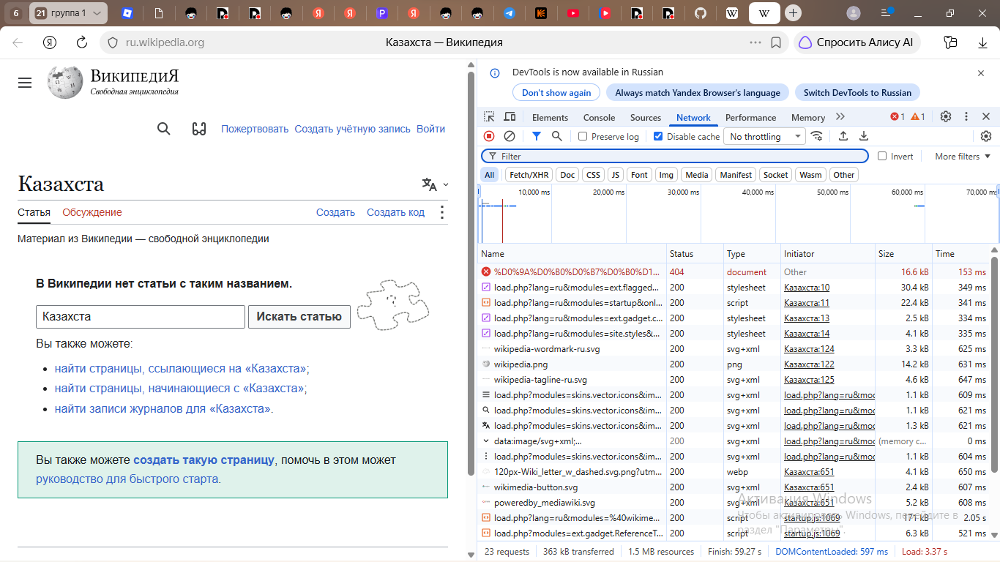
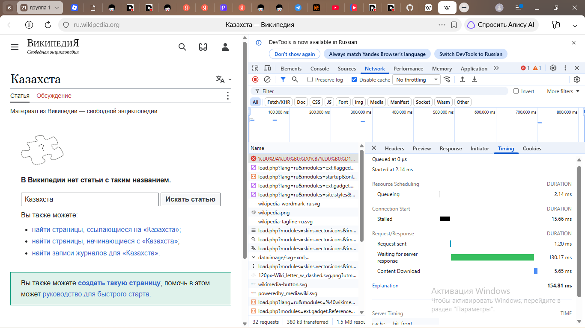
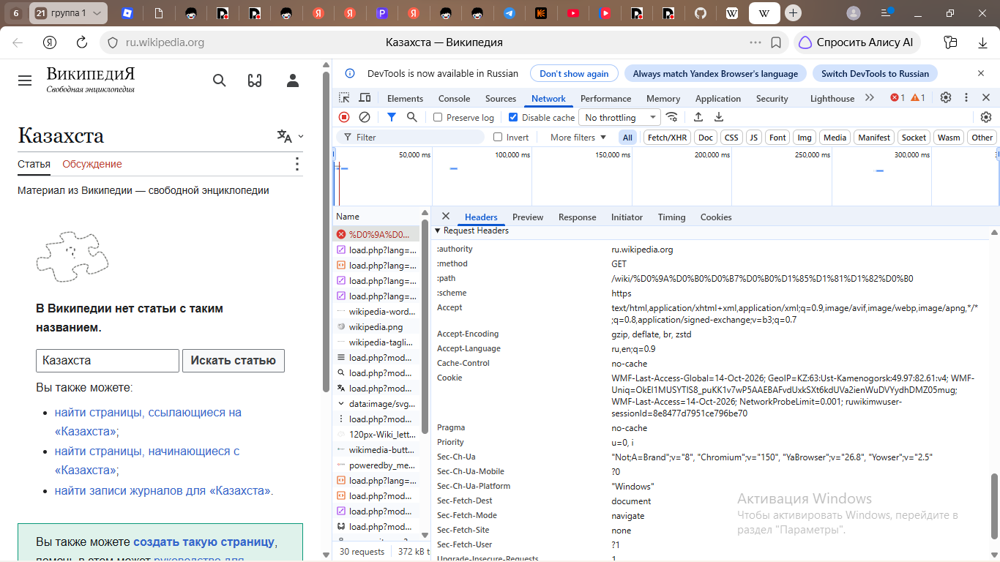
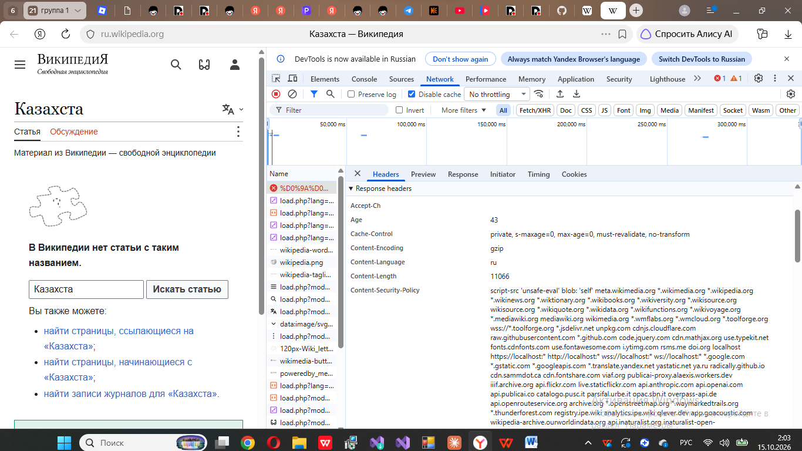
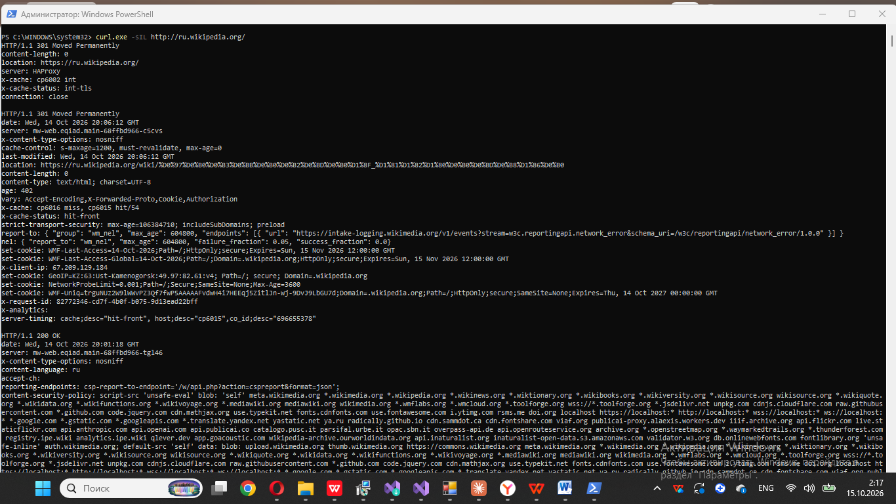
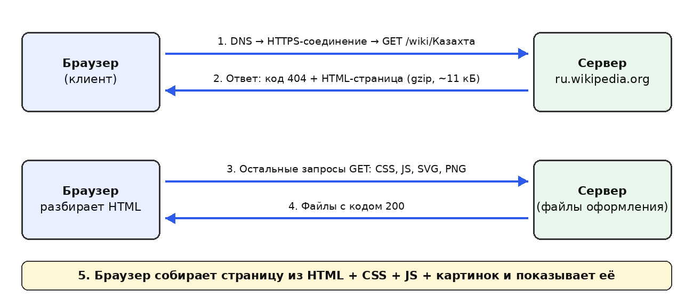
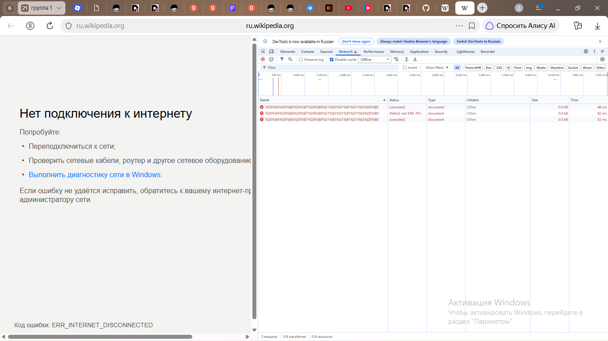

# Отчёт по практической работе № 1

**Дисциплина:** Современные веб-технологии
**Тема:** Жизненный цикл HTTP-запроса
**Выполнила:** Останина Анастасия Игоревна, 26-ИСТ-2
**Проверил:** Эгамбердиев Эльдор Улугбекович

---

**Сайт:** ru.wikipedia.org, страница https://ru.wikipedia.org/wiki/Казахта

**Примечание:** адрес набран с опечаткой, поэтому открылась несуществующая статья. Сервер вернул код 404, но всё равно отдал HTML-страницу с формой поиска. Это не мешает анализу, а помогает показать, как сервер сообщает об ошибке.

## 1. Общие показатели загрузки

- Запросов: 23 при первой загрузке (363 кБ передано), к моменту окончания загрузки в списке уже 32 запроса (380 кБ); размер ресурсов 1,5 МБ.
- DOMContentLoaded: 597 мс; полная загрузка (Load): 3,37 с.
- Типы ресурсов: document (сама страница), stylesheet (стили), script (скрипты), svg+xml, png и webp (картинки).

## 2. Waterfall (диаграмма загрузки)

*Рис. 1. Вкладка Network: список запросов и временная шкала (waterfall) вверху*

*Рис. 2. Вкладка Timing первого запроса (document): фазы загрузки*

**Фазы первого запроса (общее время 154,81 мс):**

| Фаза | Время | Что происходит |
| --- | --- | --- |
| Queueing | 2,14 мс | Запрос ждёт своей очереди в браузере. |
| Stalled | 15,66 мс | Ожидание перед отправкой: браузер готовит соединение. |
| Request sent | 1,20 мс | Браузер отправляет запрос на сервер. |
| Waiting for server response (TTFB) | 130,17 мс | Сервер обрабатывает запрос и формирует ответ. Самая долгая фаза (зелёная полоса). |
| Content Download | 5,65 мс | Скачивание тела ответа. |

Фаз DNS Lookup, Initial connection и SSL в списке нет: соединение с сервером уже было открыто браузером ранее и использовано повторно. В блоке Server Timing указано «cache — hit-front»: ответ отдан кэшем на входе в инфраструктуру сайта.

## 3. Таблица из 10 запросов

| № | Метод | Путь / имя | Код | Тип | Размер |
| --- | --- | --- | --- | --- | --- |
| 1 | GET | /wiki/%D0%9A%D0%B0%D0%B7%D0%B0%D1%85%D1%82%D0%B0 (страница «Казахта») | 404 | document | 16,6 кБ |
| 2 | GET | load.php?lang=ru&modules=ext.flagged… | 200 | stylesheet | 30,4 кБ |
| 3 | GET | load.php?lang=ru&modules=startup… | 200 | script | 22,4 кБ |
| 4 | GET | load.php?lang=ru&modules=ext.gadget.c… | 200 | stylesheet | 2,5 кБ |
| 5 | GET | wikipedia-wordmark-ru.svg | 200 | svg+xml | 3,3 кБ |
| 6 | GET | wikipedia.png | 200 | png | 14,2 кБ |
| 7 | GET | wikipedia-tagline-ru.svg | 200 | svg+xml | 4,6 кБ |
| 8 | GET | 120px-Wiki_letter_w_dashed.svg.png | 200 | webp | 4,1 кБ |
| 9 | GET | wikimedia-button.svg | 200 | svg+xml | 2,4 кБ |
| 10 | GET | poweredby_mediawiki.svg | 200 | svg+xml | 5,2 кБ |

Код 200 означает «успешно», 404 — «страница не найдена». Все запросы используют метод GET, так как браузер только получает данные.

## 4. Заголовки документа

*Рис. 3. Заголовки запроса (Request Headers)*

*Рис. 4. Заголовки ответа (Response Headers)*

| Заголовок | Значение | Назначение |
| --- | --- | --- |
| Запрос: :authority | ru.wikipedia.org | На какой сайт обращён запрос: один сервер может обслуживать много сайтов. |
| Запрос: Accept | text/html, application/xhtml+xml, … | Какие типы данных готов принять браузер; на первом месте HTML. |
| Запрос: Accept-Encoding | gzip, deflate, br, zstd | Какие способы сжатия понимает браузер; сервер выбрал gzip. |
| Запрос: Accept-Language | ru,en;q=0.9 | Предпочитаемые языки; q=0,9 — вес второго языка, сервер подбирает язык страницы. |
| Запрос: Cache-Control | no-cache | Требует не брать ответ из кэша; появился, потому что в DevTools включено «Disable cache». |
| Запрос: Sec-Fetch-Dest | document | Браузер сообщает, что запрашивает именно страницу (а не картинку или скрипт); помогает серверу защищаться от подделанных запросов. |
| Ответ: Content-Encoding | gzip | Ответ сжат, что уменьшает объём передачи. |
| Ответ: Content-Language | ru | Язык содержимого страницы. |
| Ответ: Content-Length | 11066 | Размер тела ответа в байтах (в сжатом виде). |
| Ответ: Cache-Control | private, s-maxage=0, max-age=0, must-revalidate, no-transform | private — хранить только в кэше браузера; max-age=0 — сразу считать устаревшим; must-revalidate — перед повторным использованием проверять на сервере; no-transform — промежуточные узлы не должны менять содержимое. |
| Ответ: Age | 43 | Сколько секунд ответ пролежал в промежуточном кэше: значит, он прошёл через кэширующий сервер. |
| Ответ: Content-Security-Policy | script-src … (длинный список сайтов) | Политика безопасности: перечисляет сайты, с которых странице разрешено загружать скрипты; защита от внедрения чужого кода. |

## 5. Сравнение с curl

**Команда:** `curl.exe -sIL http://ru.wikipedia.org/` (-s — без индикатора, -I — только заголовки, -L — идти по редиректам)

*Рис. 5. Вывод curl в PowerShell: цепочка редиректов*

**Цепочка редиректов (три ответа):**

| № | Адрес | Ответ сервера | Что означает |
| --- | --- | --- | --- |
| 1 | http://ru.wikipedia.org/ | 301 Moved Permanently; location: https://ru.wikipedia.org/; server: HAProxy | Переход с незащищённого HTTP на защищённый HTTPS. |
| 2 | https://ru.wikipedia.org/ | 301 Moved Permanently; location: /wiki/Заглавная_страница; server: mw-web…; cache-control: s-maxage=1200 | Корень сайта перенаправляет на заглавную страницу. |
| 3 | https://ru.wikipedia.org/wiki/Заглавная_страница (адрес из location) | 200 OK; content-language: ru | Конечная страница получена, редиректов больше нет. |

Код 301 означает «перемещено навсегда»: браузер и поисковики запоминают новый адрес. Ключ -L заставил curl пройти всю цепочку, а браузер делает это автоматически и показывает пользователю только итог.

**Отличия от того, что показал браузер:**

- curl показал дополнительные заголовки: server (mw-web — серверное приложение MediaWiki, HAProxy на первом шаге), x-cache и x-cache-status (ответ взят из кэша серверов), strict-transport-security (браузеру нужно всегда использовать HTTPS), set-cookie (сервер выдаёт cookie), vary (ответ зависит от Accept-Encoding и Cookie).
- Одинаковые заголовки совпали с браузерными: content-language: ru и content-security-policy.
- Ключ -I отправляет метод HEAD, поэтому тела ответа нет, а браузер использовал GET.
- curl отправляет минимум заголовков, а браузер добавляет много служебных (Sec-Fetch-*, Cookie, Accept-Language).

## 6. Схема архитектуры

*Рис. 6. Как браузер получает страницу*

## 7. Режимы Slow 4G и Offline

**Slow 4G.** При включённом ограничении скорости полная загрузка (Load) заняла 6,08 с против 3,37 с при обычной сети, то есть примерно в 1,8 раза дольше.

**Offline.** Страница не загрузилась: браузер показал сообщение «Нет подключения к интернету» с кодом ERR_INTERNET_DISCONNECTED. В Network отображается 3 запроса типа document со статусами (canceled) и (failed) net::ERR_INTERNET_DISCONNECTED, переданных данных 0 B.

*Рис. 7. Режим Offline: сайт недоступен, запросы завершились ошибкой*

## 8. Вывод: SPA, статика или SSR

**Сайт использует серверный рендеринг (SSR).** Обоснование по наблюдаемым признакам:

1. Код 404 вернул сам документ. Решение «такой статьи нет» принял сервер при обработке адреса. SPA отдавала бы одну и ту же оболочку с кодом 200 и показывала «не найдено» уже скриптом в браузере.
2. Первым запросом пришёл document (HTML-страница, 11066 байт в сжатом виде), а остальные запросы в списке — файлы оформления (stylesheet, script, svg, png, webp), а не запросы данных страницы.
3. В выводе curl указан server: mw-web… (серверное приложение MediaWiki), а заголовки vary: …Cookie… и set-cookie показывают, что ответ формируется сервером динамически под конкретного пользователя, а не лежит готовым статичным файлом. Кэш серверов (x-cache: hit) ускоряет выдачу, но архитектуру не меняет.

Таким образом, сайт не является ни статическим набором файлов, ни SPA: HTML-страница собирается на сервере и приходит браузеру готовой.
